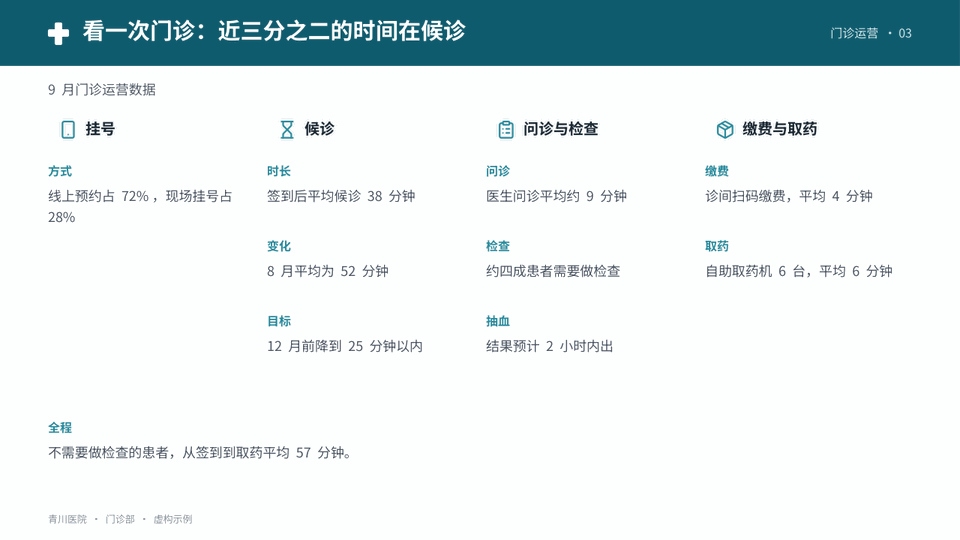
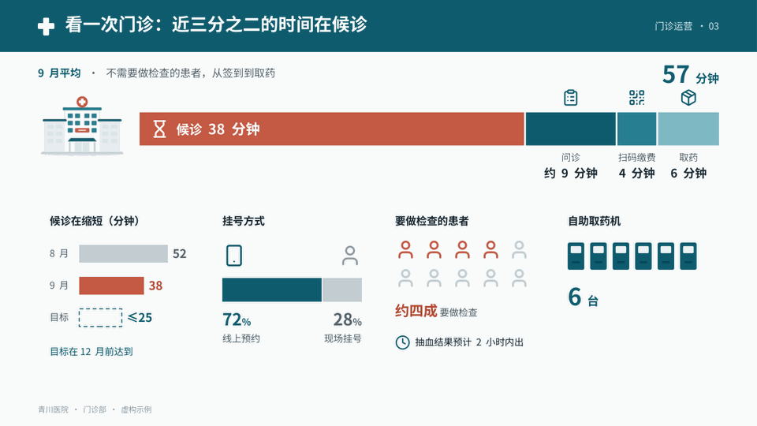

# 图片、插画、图标与图形

图像是让演示好看、让信息更快被看懂最直接的办法：一张贴切的照片、一幅讲清“是什么”的插画、一排统一的图标，往往比一段说明更快被看懂。这里说的“图”首先是照片、插画、图标和示意图，不是塞满文字的信息图；图里基本不放字，说明用原生文字放在图旁。

图示优先时，图是用来**承载信息**的，不是删掉文字后的装饰：材料里的信息一条不少，从文字搬到图上。做法见下文“把一页文字改成图”。

本文件的例子都有成品图（`assets/gallery/imagery/`），制作代码在 `examples/gallery/imagery_examples.py`。

## 每页先判断：这一页要什么图

逐页问一句：这一页讲的东西，观众能不能“看见”？

| 这一页讲的是 | 通常用 | 例子 |
|---|---|---|
| 一个看得见的东西：产品、物件、设备、门店、人、地方 | 照片或插画 | 讲冷链就让观众看见冷藏车；讲门店改造就画出门店 |
| 一种场景或氛围：产地、市场、现场 | 照片（真实）或插画场景 | 全出血照片配一句话；插画拼出“工厂—仓库—门店” |
| 数量、趋势、比较 | 原生图表 | 见 [charts.md](charts.md) |
| 一个计数（几台、几间、几个人） | 点阵或一排小图标（一个代表一个，重点的涂色），或大数字配图标 | 十位患者里四位要做检查：画十个人，涂四个；讨论室 6 间就画 6 间 |
| 一个比例 | 比例条、大数字 | 线上预约 72%、现场 28% |
| 一段时长、一天里的时段 | 按比例的时间条、时间轴 | 从签到到取药 57 分钟，候诊那一段占了大半 |
| 东西或钱往哪里走、走多少 | 箭头，宽窄表示量，方式写成箭头旁的小标签 | 每月边角料分三路：回炉、卖给回收商、填埋，按吨数画宽窄 |
| 步骤、关系、结构 | 原生形状和连线，节点配图标或小插画 | 流程、架构、议题树 |
| 有没有、行不行 | 勾和叉、实线和虚线，配短标签 | 一周七格：五天开放、周六试点、周日不开 |
| 地点和分布 | 示意分布：按大致方位摆圆点，大小表示数量，不画边界 | 开放日各展点的人数；要比多少时改成排序条形图 |
| 一组并列的条目或指标 | 每条一个图标加短标签 | 表头、卡片标题、关键数字旁 |
| 一句结论、一个问题 | 排版本身 | 超大字、留白、色块 |

- 需要图、工具也做得到时，**实际去找、去画、去生成**，不能只在策划稿里写“配图”。
- 不按图片数量判断好坏：纯文字更清楚的页面就用文字；为了凑图而放无关的图更糟。
- 没有搜索工具不等于“没有素材”：先用自带插画、自己画 SVG；确实做不到时在策划稿如实写明。

## 把一页文字改成图：信息不减

图示优先最常见的失败，是把字删了却没把图补上：页面变空，信息比材料少。正确的做法是换载体：

1. **列条目**：把这页在材料里的内容拆成条目，一个事实、一个数字、一个步骤、一个条件各算一条，连同对象、时间起点、条件和状态（约、预计、估算、建议）一起记下。一页常有 8–15 条。
2. **分配**：逐条按上表决定怎么画；画不出来的（结论、条件、口径）留成短文字。用户的偏好是十条里大约七条用图、三条用字；这是方向，不必数够，也不为凑数拆条目或加图标。
3. **排**：按信息之间的关系排，而不是按条目顺序排成清单。先后画成时间条或流程，多少放在同一把尺上，去向画成宽窄不同的箭头，位置画成示意分布；几件并列的事各占一块，每块一张小图。
4. **核对**：做完对照清单逐条看，条目一条不少，限定没有丢（“约 120 吨”不能变成“120 吨”，“预计明年”不能变成“明年”），大部分在图里。图旁可以有不少短标签，这没关系；要避免的是成段的句子。字放不下时拆页或换画法，不把字缩小（下限见 [typography.md](typography.md) 的字号阶梯）。

“标签＋一行字”排成的格子不算图示：每格仍要读一句话，看不出哪个是物件、哪个是数量、哪个是流向。图标只放在格子标题前，也只是装饰。

公司模板同样这样做：模板限制母版、字体、配色和固定元素，不限制图。插画用模板的主题色换色，放在内容区里。

同一页改写前和改写后的对照，套在三个虚构机构的模板里：青川医院（页眉色带）、启明中学（左侧竖条）、恒川电机（顶部细条、页脚标志）。模板的配色、字体、页眉页脚不变，图放在内容区。每组的 A、B 页依据同一份材料（代码里每组旁边的 `*_FACTS` 列表和它的数字），名字和数字都是编的。制作代码在 `examples/gallery/convert_examples.py`：




| 页面 | 改写前 | 改写后 | 改写后主要用了 |
|---|---|---|---|
| C01 门诊时间（医院） | [C01-a](../assets/gallery/convert/C01-a.png) | [C01-b](../assets/gallery/convert/C01-b.png) | 按分钟比例的时间条、三根变化条、比例条、十个人涂四个、六台取药机 |
| C02 边角料去向（工厂） | [C02-a](../assets/gallery/convert/C02-a.png) | [C02-b](../assets/gallery/convert/C02-b.png) | 工厂和货车插画、按吨数画宽窄的流向、箭头上的结算方式、12 → 0、两根处置费条 |
| C03 图书馆改造（学校） | [C03-a](../assets/gallery/convert/C03-a.png) | [C03-b](../assets/gallery/convert/C03-b.png) | 座位方格（缺口用虚线）、时间轴、两根柱、逐台逐间画出的设施、比例条、一周七格 |
| C04 开放日人数（学校） | [C04-a](../assets/gallery/convert/C04-a.png) | [C04-b](../assets/gallery/convert/C04-b.png)、[C04-c](../assets/gallery/convert/C04-c.png) | B 按大致位置摆圆点，C 把同样的数排序成条形图 |
| C05 设备方案（工厂） | [C05-a](../assets/gallery/convert/C05-a.png) | [C05-b](../assets/gallery/convert/C05-b.png) | 为这个例子画的空压机插画、同尺投入条（按月付的租赁不上这把尺）、停机天数方块、电耗剩余长度、四段回收条 |

C04 的两种画法回答不同的问题：位置图展示各展点的相对方位和人流集中在哪一片，排序条形图更容易比较谁多谁少。位置示意不按比例，不能据此判断实际距离或规划具体路线；要讲距离或路线，就用有依据的平面图或路径资料。先想这一页要观众回答什么，再选主要画法；两个问题都要回答时，主图选一种，另一种做小图。B 页的方位是为示例另设的示意布局（代码里的 `PLACES`），不是从人次推出来的。

## 四种来源

可以单独用，也可以组合（照片做封面，插画讲流程，图标标条目）。一套演示里照片的调色要统一，插画只用一种风格。

### 1. 用户提供的图片

要证明真实存在的人物、客户、产品、门店、现场时，只用用户提供的或经核实的真实来源。网上找来的照片、插画和生成图都不能冒充“对方的照片”。

### 2. 网络图片（开放许可）

用 `scripts/find_images.py` 搜 Openverse（汇集 Flickr、维基共享资源等的开放许可图片）和维基共享资源，结果带作者和许可：

```bash
# 1. 搜：英文关键词通常结果更多；默认只要可商用、可修改的许可（CC0、公有领域、CC BY、CC BY-SA）
python scripts/find_images.py search "fresh vegetables market stall" --orientation landscape \
    --json build/img/veg.json --sheet build/img/veg.png
# 2. 看 build/img/veg.png：带编号的候选总览。标题经常和画面对不上，一定要看图选
# 3. 下载选中的那张，并把来源和署名追加进 sources.md
python scripts/find_images.py get 4 --json build/img/veg.json --out build/img/tomatoes.jpg --record sources.md --page 5
# 4. 打开下载的原图：主体、清晰度、水印、图里的文字、和事实是否冲突
```

挑图看这几点（例：）：

- **主体**：画面就是这一页讲的东西，不是只沾边的“氛围图”。
- **清晰度**：原图宽度至少是版位宽度的 1.5 倍；全出血至少 1600px 宽。
- **干净**：没有水印、没有醒目的品牌标识；画面里有文字（价签、招牌）时裁掉或换图。
- **许可**：

  | 许可 | 能否商用、修改 | 署名 |
  |---|---|---|
  | CC0、公有领域（PDM） | 可以 | 不需要，写进 sources.md 即可 |
  | CC BY | 可以 | 需要：作者、许可、链接，放在图旁小字或备注 |
  | CC BY-SA | 可以 | 需要；改过的图按同一许可，备注写明 |
  | 含 NC（非商业）或 ND（禁止演绎） | 公司演示不用；ND 不能裁切调色 | — |
  | 图库网站（Unsplash、Pexels 等）| 按各站许可，多数可商用 | 不强制，建议在备注写来源 |

- **人物**：能认出脸的人，不要给他编身份或台词（“合作农户张师傅说……”）；用作示意时写“示意图片”。
- agent 有浏览器时也可以直接在图库网站找，同样要打开原图核对、记录来源。没有联网能力时改用插画、图标或排版，并在策划稿写明。

### 3. SVG 插画

`assets/illustrations/` 是自带的物体和场景插画，先看 [`README.md`](../assets/illustrations/README.md)：

- 现有两种风格只是样本：`flat`（扁平圆润，41 个）和 `line`（线描，8 个）。每个文件夹有 `sheet.png` 总览和 `INDEX.md` 索引。
- 给出主色和强调色就整体换色：`deck.illustration(slide, "truck", x, y, w, h, primary="0B3D91", accent="E8590C")`；一排物体拼成场景：`deck.illustration(slide, ["factory", "truck", "store"], ...)`。
  
- 库里没有的，照 README 的步骤补画，或只为这个项目画：从最接近的图改起，用同样的画布、地平线和占位色，`illustrations.py check` 检查，渲染出来和同风格的图放在一起看。
  
- 这份演示需要别的画风（等距、手绘、剪纸……），就新建一个风格或只为项目画；不必迁就现有风格。
- 插画里不放文字，不画数量和比例（那是图表的事）。
- **插画和它说明的内容对得上**：观众要看得出每幅插画对应哪一栏或哪一项。常见做法是把物体放在它那一栏的栏头或那一项旁边；不要求一栏一幅，一幅插画也可以只配给最需要“看见”的那一项。要避免的是对不上：四个物体排成一排、摆在三栏下面，观众会去找对应关系却找不到。整排场景本身就是内容（一条流程从头到尾）时可以拼成一排，并让每站的标签对齐各自的物体。

### 4. 生成图

环境提供图像生成工具时可用，适合主视觉、氛围和概念示意。

- 先为全套写一段固定的**风格锚**，附在每个提示词末尾，例如：`editorial photography, soft natural window light, muted warm palette with deep teal shadows, subtle film grain, 35mm lens, calm and minimal composition`。
- 每个提示词写清主体与场景（具体到物、动作、环境）、构图与留白（例如“主体在右三分之一，左侧干净的暗部留给标题”）、比例（全出血 16:9，半页 4:5 或 1:1）、色调，以及 `no text, no letters, no logos, no watermark`。
- 先生成 1–2 张放进页面看，成立了再批量；逐张检查乱码文字、畸形的手、塑料质感、品牌标识和与事实冲突之处，有问题就重新生成，不靠裁切遮掩。
- 生成图不能冒充真实证据、真实产品或真实人物，必要时标注“示意”。

## 两个完整例子

**例一：给“社区店的叶菜”配一张照片**（第 5 页，图示优先）

1. 判断：这一页讲叶菜在门店的样子，观众需要“看见”，配照片。
2. 搜：`find_images.py search "fresh vegetables market stall" --orientation landscape --sheet build/img/veg.png`，打开总览看 16 张候选。
3. 选：有一张番茄篮子构图很好，但画面里有价签（要用就裁掉）；有一张人物脸部清楚，不宜配“店员”之类的身份；有两张的标题写着“蔬菜”，画面却是落叶和汤。最后选一张主体清楚、公有领域的萝卜特写。
4. 下载并记录：`find_images.py get … --record sources.md --page 5`；打开原图确认没有水印。
5. 处理：全套照片统一降饱和、偏暖（`image_fx.py grade --saturation 0.75 --warmth 0.05`）。
6. 放进页面：照片占 7 栏并出血，文字挂在另一侧（见 [layouts.md](layouts.md) 的 L16）；渲染后看照片和标题是否互相干扰。
7. 策划稿写：“第 5 页：照片 radishes.jpg（USDA，公有领域），已调色；文字两行”。

**例二：给“从地里到家里”的流程配插画**（第 3 页）

1. 判断：五个环节各有一个看得见的东西（农田、货车、仓库、门店、人），用插画链条，比五个文字框好懂。
2. 做：每站单独放一张，各自对齐自己的标签（见 L12 的 B）；只要一条整体的场景时才用 `deck.illustration(slide, ["farm", "truck", "warehouse", "store"], ...)` 拼成一排。
3. 每站下面只放两字标题和一个时间，解释进备注。
4. 渲染后看：车辆和建筑的大小关系是否自然、标签是否对齐、换色后是否还分得清。

## 处理照片

PPTX 不能用 CSS 滤镜，用 `scripts/image_fx.py` 先处理再插入；HTML 可以用同样的文件，或用 CSS。

| 手法 | 用途 | 命令 |
|---|---|---|
| 统一调色 | 不同来源的照片融成一套 | `image_fx.py grade in.jpg out.jpg --saturation 0.7 --warmth 0.06` |
| 黑白 | 理性、克制、纪实感 | `image_fx.py gray in.jpg out.jpg --contrast 1.3` |
| 双色调 | 强烈的品牌感，统一杂乱的素材 | `image_fx.py duotone in.jpg out.jpg --dark 1B2A4A --light F2E9D8` |
| 压暗 | 整张做背景、上面压字 | `image_fx.py darken in.jpg out.jpg --amount 0.4` |
| 圆角、圆形 | 呼应圆角风格；人像头像 | `image_fx.py round … --radius 40`、`image_fx.py circle …` |
| 颗粒 | 胶片、印刷感，消除大面积渐变的色带 | `image_fx.py grain out.png --amount 0.06`，铺在最上层 |
| 柔光、点阵、半调底图 | 发布会光感、手账纸、复古印刷 | `image_fx.py glow / dots / halftone out.png` |


- **文字压在照片上**：只在文字一侧加渐变遮罩（`deck.gradient_rect`），不要整张盖一层黑。
  
- **裁切**：主体的视线或运动方向朝向页面内部；局部特写（手、材质、细节）往往比平淡的全景更有力；不要切掉主体。PPTX 的 `deck.picture` 默认按版位比例裁切填满。
  
- **抠图出框**需要真正的透明 PNG（用户素材或可用的去背工具）；做不到时不要用粗糙的边缘冒充。
- 体积：PPTX 里的图片按版位约 2 倍导出，单张一般不超过 1MB；HTML 内联照片用 JPEG 或 WebP。

## 图标

图标让表格、卡片、流程和数字更好认。

- **来源**：`assets/icons/`（Lucide 线性图标子集，ISC 许可，名称和含义见 `INDEX.md`）。缺的从同一套 Lucide 补充（保留许可），或用基本形状画同样线宽的图标；一套演示不混用多种图标风格。
- **用在哪里**：表头和行首、卡片和要点的标题前、流程和架构的节点、关键数字旁；放大的单个图标也可以做章节页的母题。
- **统一**：一种线宽、一两种颜色，同级同样大小，与旁边文字对齐；找不到贴切的就不用，不用灯泡、火箭这类空泛的图标凑数。不用 emoji。
- **PPTX**：`deck.icon(slide, "factory", x, y, size=32, color="1E5AA8")` 生成一个原生形状，能改颜色、缩放不糊；约 96px 以上可把 `stroke` 调细到 1.5。**HTML**：内联 SVG 源码，`stroke="currentColor"` 跟随文字颜色。


## 不用图片时的图形手法

这些不是“没有素材时的退路”，而是和照片、插画并列的选择：

- **超大排版**：关键词、数字或章节编号放到 200px 以上，裁出页边。
- **母题图形**：从主题提炼一个图形贯穿全套，例如物流的路线虚线、金融的刻度、城市的建筑网格、东方主题的界格。
- **数据即图形**：用真实数据画出的线、点或条做封面和章节页的主视觉，比抽象装饰更有意义。
- **色块构成**：两三块颜色分割页面，配合大字，形成海报感。

HTML 用内联 SVG 或 CSS 画；PPTX 用原生形状（`deck.polygon`、`deck.rect`、`deck.ellipse`），复杂的可以预渲染成 PNG 作背景，文字保持原生。

## 可编辑范围

| 对象 | PPTX 里是什么 | 能改什么 |
|---|---|---|
| 照片、插画、生成图、底纹 | 图片 | 移动、缩放、裁切、替换；插画要改画面就改 SVG 源文件后重新生成 |
| 图标 | 原生形状 | 颜色、大小、位置 |
| 母题图形、色块、箭头 | 原生形状 | 全部 |
| 文字、图表、表格 | 原生对象 | 全部 |

不把整页做成图片，也不把带文字的图片当成可编辑内容交付。

## 标志

使用官方提供的标志文件，不拉伸、不改比例、不改颜色；深色背景用反白版本，没有就放在浅色底块上。
